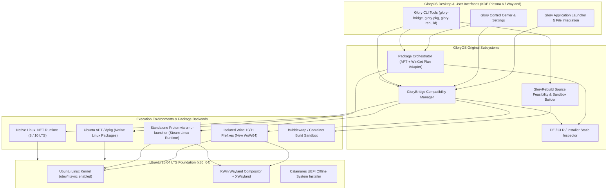

# GloryOS System Architecture & Integration Contracts

**Philosophy:** *Linux infrastructure. Windows application compatibility. Open-source freedom.*

---

## 1. Architectural Overview

GloryOS is a modular, Ubuntu LTS–based `x86_64` operating system that combines a Wayland-first KDE Plasma 6 desktop with first-class, transparent Windows and cross-platform `.NET` application orchestration — without proprietary backends, mandatory Steam installations, or upstream project forks.



---

## 2. Repository Structure

Every directory has a single responsibility and maps cleanly to engineering roles and milestones:

```text
GloryOS/
├── .agents/
│   └── environment.json          # Reproducible cloud dev-workspace bootstrap
├── .github/
│   └── workflows/ci.yml          # Automated lint, typecheck, contract, audit & unit tests
├── configs/
│   └── distro/
│       └── gloryos-base.yaml     # Declarative Ubuntu LTS base & layer manifest
├── docs/
│   ├── PREFLIGHT.md              # Resource audit, upstream status, licenses & limitations
│   ├── ARCHITECTURE.md           # System architecture & inter-agent contracts (this file)
│   └── ROADMAP.md                # Phased M0–M9 engineering plan
├── schemas/                      # Machine-validated JSON Schema integration contracts
│   ├── compatibility-profile.schema.json
│   ├── distro-manifest.schema.json
│   ├── executable-inspection.schema.json
│   └── install-plan.schema.json
├── src/
│   └── gloryos_core/             # Core contract validation, preflight & shared foundations (M0+)
├── image/                        # Reproducible rootfs, UEFI ISO, QCOW2 & Calamares configs (M1, M9)
├── desktop/                      # KDE Plasma 6 branding, Dolphin actions & Qt6/QML tools (M2)
├── packaging/                    # Native .deb definitions & APT/WinGet mapping tables (M7)
├── scripts/
│   └── setup-dev-env.sh          # Idempotent non-interactive toolchain installer
├── tests/                        # Automated unit, schema contract & regression test suites
├── LICENSE                       # GNU GPL v3.0
├── THIRD_PARTY_NOTICES.md        # Upstream attribution & SPDX license ledger
├── Makefile                      # Standard build, lint, test, audit & preflight entrypoints
└── pyproject.toml                # Python package, ruff, mypy & pytest configuration
```

*(Future subsystems are added cleanly under `src/` as milestones unlock: `src/glory_bridge/` in M3–M6, `src/glory_pkg/` in M7, and `src/glory_rebuild/` in M8.)*

---

## 3. Subsystem Specifications

### 3.1 Base OS & Boot/Install Pipeline (`image/`)
- **Base:** Ubuntu 26.04 LTS (`resolute`, `x86_64`) bootstrapped reproducibly via `mmdebstrap`.
- **Kernel Tuning:** Standard `linux-image-generic` with `/etc/modules-load.d/gloryos-ntsync.conf` (`ntsync`) and udev permissions so Wine 11+ and Proton access fast kernel NT synchronization primitives out of the box.
- **Display Stack:** SDDM + KDE Plasma 6 Wayland session (`plasma-workspace`, `kwin-wayland`, `xwayland`, Mesa Vulkan/OpenGL drivers).
- **Installer:** Calamares (`calamares`) configured for offline UEFI GPT installation, zero mandatory online accounts, and automatic license/SBOM preservation under `/usr/share/gloryos/manifests/`.

### 3.2 GloryBridge (`src/glory_bridge/`, Milestones M3–M6)
GloryBridge is GloryOS's unified inspection, prefix management, and launcher subsystem for Windows executables and portable `.NET` binaries.

1. **Static Binary & Installer Inspection (`Inspector`):**
   - Parses PE headers (`PE32` x86, `PE32+` x86_64, subsystem GUI vs CUI) via `pefile` without executing anything.
   - Extracts DLL import tables (`KERNEL32.dll`, `d3d11.dll`, `d3d12.dll`, `vulkan-1.dll`, `Qt6Core.dll`, `SDL2.dll`).
   - Detects installer packaging signatures (`Inno Setup`, `NSIS`, `WiX/MSI`, `Burn`, `7z SFX`, `MSIX`).
   - Inspects `.NET` CLR headers (`COM_DESCRIPTOR`), `runtimeconfig.json`, referenced managed assemblies (`PresentationFramework`, `System.Windows.Forms`, `Avalonia`), and native P/Invoke modules.
   - Flags hard blockers (`ntoskrnl.exe` / `.sys` kernel drivers, known kernel anti-cheat bootstrappers, 16-bit `NE`/`MZ` headers) before execution.
2. **Environment Routing Decision Engine:**
   - **Portable Cross-Platform `.NET`:** Routed to native Linux `dotnet` (`/usr/bin/dotnet`).
   - **Desktop Productivity / Standard Win32 / WPF / WinForms:** Routed to an isolated **GloryBridge Wine Prefix** (`~/.local/share/glorybridge/prefixes/<profile-id>/`) using `wine` (new WoW64 mode, XWayland default, optional native Wayland).
   - **DirectX 9/10/11/12 & Vulkan Games:** Routed to **Standalone Proton** via `umu-run` (`Open-Wine-Components/umu-launcher`) inside Valve's open-source `SteamLinuxRuntime_sniper` container — **zero Steam client required**.
3. **Safety & Desktop Integration:**
   - **Never** auto-executes downloaded `.exe` or `.msi` installers; installers always present an inspection summary and require explicit user confirmation.
   - Generates XDG `.desktop` shortcuts (`~/.local/share/applications/glorybridge-*.desktop`) annotated with `X-GloryOS-Profile` and `X-GloryOS-Runtime` metadata for Plasma launcher badges.
   - Captures structured exit diagnostics (`logs/<run-id>.json`) when an application fails.

### 3.3 APT & WinGet Integration (`src/glory_pkg/`, Milestone M7)
- **APT First:** Native Linux software is always managed directly via Ubuntu's `apt` / `dpkg` infrastructure. GloryOS never replaces APT or hosts a custom package backend.
- **WinGet Manifest Plan Adapter:**
  1. Reads declarative YAML manifests from local checkouts or shallow fetches of `microsoft/winget-pkgs` (MIT).
  2. Validates manifest syntax (`InstallerType`, `Architecture`, `InstallerUrl`, `InstallerSha256`).
  3. Checks `packaging/native-alternatives.yaml`: if a native Ubuntu/APT package exists (e.g., `Mozilla.Firefox`, `VideoLAN.VLC`, `Git.Git`, `BlenderFoundation.Blender`), recommends the native APT installation plan first.
  4. Otherwise produces a validated **`InstallPlan`** (`schemas/install-plan.schema.json`) detailing download URL, mandatory SHA-256 hash, installer type (`inno`, `nullsoft`, `msi`, `portable`), target isolated GloryBridge prefix, and compatibility warnings.
  5. **Hard Safety Rule:** `requires_user_authorization` is always `true`. Arbitrary shell strings or unverified downloads are never executed.

### 3.4 GloryRebuild (`src/glory_rebuild/`, Milestone M8)
- Analyzes open-source repositories (linked from WinGet `PackageUrl`/`PublisherSupportUrl` or user-supplied Git URLs).
- Detects build systems (`CMakeLists.txt`, `meson.build`, `Cargo.toml`, `*.csproj`, `go.mod`) and scans source headers/imports for Win32/DirectX/MFC/WPF lock-in (`<windows.h>`, `<d3d11.h>`, `UseWPF`, `UseWindowsForms`).
- Emits a structured **Portability & Recompile Feasibility Report** (`feasible_native`, `requires_porting`, `windows_locked`, or `closed_source`).
- For `feasible_native` projects with permissive/compatible open-source licenses, runs an isolated, network-restricted build inside `bubblewrap` without modifying upstream Git history, packaging outputs into a local `.deb` carrying upstream `LICENSE`/`COPYING` files.

### 3.5 Glory Desktop Integration (`desktop/`, Milestone M2)
- Built on upstream KDE Plasma 6 (`plasma-desktop`, `kwin-wayland`, `dolphin`).
- Lightweight, maintainable customizations only:
  - GloryOS Look-and-Feel package, wallpaper, Plymouth theme, SDDM theme, and `/etc/os-release` identity.
  - Dolphin Service Menu (`Inspect / Launch with GloryBridge`) for `.exe` and `.msi` files.
  - `Glory Control Center` (Qt6 / PySide6 + Kirigami) surfacing prefix management, `.NET` / Wine / Proton runtime health, `/dev/ntsync` status, and compatibility diagnostics.

---

## 4. Security & Safety Invariants

1. **Host Immutability:** Build, rootfs assembly, and OS installation tests execute exclusively in `work/`, `out/`, `bubblewrap` namespaces, or QEMU virtual machines — never touching host `/etc`, `/usr`, or user home files silently.
2. **No Silent Execution:** Inspecting an executable (`PE`/`CLR`/WinGet YAML) is strictly static (`pefile` / YAML parser). Installers never run without interactive confirmation or an explicit `--authorize-plan <sha256>` CLI flag.
3. **Cryptographic Verification:** Every external artifact downloaded by WinGet plans or runtime fetchers must match a pinned `SHA-256` digest prior to staging.
4. **Prefix Isolation:** Windows applications default to per-app or per-profile prefixes without mapping `$HOME` writable root drives (`Z:\` exposure restricted/configurable).

---

## 5. Engineering Roles & Interface Contracts

To prevent incompatible parallel implementations, all 9 engineering roles coordinate exclusively through versioned JSON Schemas in [`schemas/`](../schemas/):

| Role | Owned Directories | Consumes Contract(s) | Produces Contract(s) / Deliverables |
| :--- | :--- | :--- | :--- |
| **Architect** | `docs/`, `schemas/`, `configs/` | Preflight metrics | `schemas/*.schema.json`, `ARCHITECTURE.md`, ADRs |
| **Linux Engineer** | `configs/distro/`, `image/overlays/` | `distro-manifest.schema.json` | Ubuntu LTS package layers, `ntsync` & Wayland sysctl/udev configs |
| **Build Engineer** | `image/`, `scripts/` | `distro-manifest.schema.json` | `mmdebstrap` + `xorriso` UEFI ISO, QCOW2 VM, SBOM & license manifests |
| **Desktop Engineer** | `desktop/` | `compatibility-profile.schema.json`, `executable-inspection.schema.json` | KDE Plasma 6 branding, Dolphin service menus, Glory Control Center |
| **Runtime Engineer** | `src/glory_bridge/inspector/` | Raw PE/CLR files | `executable-inspection.schema.json` reports, native Linux `.NET` launcher |
| **Compatibility Engineer** | `src/glory_bridge/` | `executable-inspection.schema.json` | `compatibility-profile.schema.json`, Wine & standalone Proton (`umu-run`) orchestration |
| **Package Engineer** | `src/glory_pkg/`, `packaging/` | `winget-pkgs` YAML, APT cache | `install-plan.schema.json`, native Linux mapping table, `.deb` packaging |
| **QA Engineer** | `tests/`, `.github/workflows/` | All `schemas/*.schema.json` | Automated unit tests, QEMU UEFI serial boot smoke tests, regression suites |
| **Security Auditor** | `THIRD_PARTY_NOTICES.md`, `Makefile` (`audit`) | `install-plan.schema.json`, `executable-inspection.schema.json` | `pip-audit` / `lintian` gates, SHA-256 enforcement, prefix/sandbox boundary audits |
