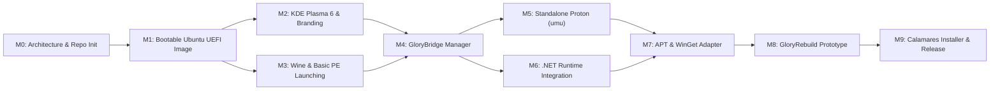

# GloryOS Phased Implementation Roadmap (M0–M9)

> **Milestone Discipline:** Never start a later milestone until all automated tests, static checks, and acceptance gates of its prerequisite milestones pass reproducibly.

---

## Smallest Working M0 Milestone (Current Target)

**Goal:** Establish an auditable, reproducible repository foundation, upstream/license verification, machine-validated inter-agent contracts, static analysis, dependency auditing, and environment preflight tooling — **without downloading multi-gigabyte OS/desktop dependencies prematurely**.

### M0 Deliverables
1. Preflight & resource report ([`docs/PREFLIGHT.md`](PREFLIGHT.md)), system architecture ([`docs/ARCHITECTURE.md`](ARCHITECTURE.md)), and phased roadmap ([`docs/ROADMAP.md`](ROADMAP.md)).
2. Open-source licensing (`LICENSE` — `GPL-3.0-or-later`) and third-party ledger ([`THIRD_PARTY_NOTICES.md`](../THIRD_PARTY_NOTICES.md)).
3. Reproducible workspace environment bootstrap ([`.agents/environment.json`](../.agents/environment.json) + [`scripts/setup-dev-env.sh`](../scripts/setup-dev-env.sh)).
4. Machine-validated JSON Schema contracts ([`schemas/`](../schemas/)) and base Ubuntu LTS manifest ([`configs/distro/gloryos-base.yaml`](../configs/distro/gloryos-base.yaml)).
5. `gloryos-core` Python package ([`src/gloryos_core/`](../src/gloryos_core/)) providing contract validation and non-destructive `gloryos-preflight` CLI checks.
6. Automated CI quality gates (`ruff`, `mypy --strict`, `shellcheck`, `pytest`, `pip-audit`) passing via `make check`.

---

## Phased Milestones Overview

### M0 — Architecture and Repository Initialization
- **Prerequisites:** None.
- **Owner Roles:** Architect, QA Engineer, Security Auditor.
- **Exit Gate:** `make check` exits `0`; all schemas, base manifest, unit tests, static analysis, and dependency vulnerability audits pass cleanly.

### M1 — Bootable Ubuntu-Based GloryOS UEFI Image
- **Prerequisites:** M0 complete; user approval prior to downloading Ubuntu base rootfs packages (~350–600 MB).
- **Owner Roles:** Linux Engineer, Build Engineer, QA Engineer.
- **Deliverables:**
  - `image/build-iso.sh` using `mmdebstrap` (`Ubuntu 26.04 LTS resolute`), `mksquashfs`, `grub-mkstandalone` (`BOOTX64.EFI`), and `xorriso`.
  - `/etc/os-release` (`GloryOS`), `/etc/modules-load.d/gloryos-ntsync.conf`, SBOM (`manifest.packages`), and license bundle (`manifest.licenses`).
  - `image/test-qemu-uefi.sh`: boots the generated UEFI image in headless `qemu-system-x86_64` + `OVMF` (`-accel kvm:tcg`) over `ttyS0` and asserts clean systemd boot + `GloryOS` identity.
- **Exit Gate:** Deterministic ISO + QCOW2 build and automated QEMU UEFI boot test pass end-to-end.

### M2 — KDE Plasma 6 Integration and Branding
- **Prerequisites:** M1 passing.
- **Owner Roles:** Desktop Engineer, Build Engineer.
- **Deliverables:**
  - Minimal KDE Plasma 6 Wayland + KWin + XWayland + SDDM package layer (`plasma-desktop`, `kwin-wayland`, `xwayland`, `dolphin`, `konsole`) without Ubuntu Snap bloat.
  - `.deb`-packaged `gloryos-desktop-branding` (Look-and-Feel, wallpaper, SDDM/Plymouth config, launcher categorization) and Dolphin `.exe`/`.msi` right-click service menu stub.
  - Initial `Glory Control Center` shell (Qt6 / Kirigami) displaying system & compatibility runtime status.
- **Exit Gate:** `.deb` passes `lintian`; Plasma Wayland session starts cleanly inside QEMU VM test.

### M3 — Wine Installation and Basic Windows Executable Launching
- **Prerequisites:** M1 passing.
- **Owner Roles:** Compatibility Engineer, Runtime Engineer, QA Engineer.
- **Deliverables:**
  - Wine 10/11 (`new WoW64` mode) layer configuration + `ntsync` udev rule (`0660` `/dev/ntsync`).
  - Static PE32/PE32+ binary inspector (`src/glory_bridge/inspector/pe.py`) producing `executable-inspection.schema.json` reports.
  - Safe CLI wrapper launching a cross-compiled `mingw-w64` test `.exe` inside an isolated temporary `WINEPREFIX` (headless/Xvfb/Wayland verified).
- **Exit Gate:** Automated PE inspection tests and isolated Wine `.exe` execution smoke test pass; downloaded installers are blocked from auto-execution.

### M4 — GloryBridge Compatibility Manager
- **Prerequisites:** M2 and M3 passing.
- **Owner Roles:** Compatibility Engineer, Desktop Engineer, Security Auditor.
- **Deliverables:**
  - Full `glory-bridge` prefix lifecycle manager (create, list, inspect, clone, purge isolated prefixes; restrict `Z:\` host root exposure).
  - Per-application compatibility profiles (`compatibility-profile.schema.json`), `.desktop` shortcut generator with compatibility badges, and structured crash/exit diagnostic reports.
  - Kernel-driver / anti-cheat / 16-bit incompatibility detector with clear user-facing warnings.
- **Exit Gate:** Profile schema validation, prefix isolation audit, `.desktop` generation, and failure-diagnostic tests pass.

### M5 — Independent Proton Integration
- **Prerequisites:** M4 passing.
- **Owner Roles:** Compatibility Engineer, Security Auditor.
- **Deliverables:**
  - Integration of `Open-Wine-Components/umu-launcher` (`umu-run`) + open-source Proton runner discovery/management with **zero Steam client dependency**.
  - Automatic routing of DirectX (`d3d9`/`d3d11`/`d3d12`) and Vulkan applications to Proton profiles with DXVK/VKD3D-Proton telemetry-free diagnostics.
- **Exit Gate:** Proton profile launches test DirectX/Vulkan binary via `umu-run` without `steam` installed.

### M6 — .NET Runtime Integration
- **Prerequisites:** M4 passing.
- **Owner Roles:** Runtime Engineer, Compatibility Engineer.
- **Deliverables:**
  - CLR metadata analyzer distinguishing portable cross-platform `.NET` (`Console`, `ASP.NET`, `Avalonia`) from Windows-bound `.NET` (`net4x`, `WPF`, `WinForms`, `WinUI 3`, Win32 P/Invoke).
  - Native Ubuntu `dotnet-runtime-8.0` / `10.0` direct execution path for portable assemblies, and isolated Wine-Mono / Windows `.NET Desktop Runtime` recipe path for Windows-specific `.NET` apps.
- **Exit Gate:** Automated test suite verifies portable `.dll`/apphost runs natively on Linux `dotnet` while WPF/WinForms test metadata routes cleanly to GloryBridge Wine prefix.

### M7 — APT and WinGet Integration
- **Prerequisites:** M5 and M6 passing.
- **Owner Roles:** Package Engineer, Security Auditor.
- **Deliverables:**
  - `glory-pkg` CLI & library integrating native `apt` queries alongside a read-only `microsoft/winget-pkgs` YAML manifest parser.
  - Curated native-Linux priority table (`packaging/native-alternatives.yaml`) recommending native APT packages before Windows installers.
  - Validated `InstallPlan` generator enforcing SHA-256 verification, `msix`/`appx` rejection, human-readable plan output, and mandatory user confirmation.
- **Exit Gate:** Malformed, hash-mismatched, or unauthorized manifests are deterministically rejected; valid manifests produce schema-compliant plans.

### M8 — GloryRebuild Prototype
- **Prerequisites:** M7 passing.
- **Owner Roles:** Runtime Engineer, Package Engineer, Security Auditor.
- **Deliverables:**
  - `glory-rebuild` static repository analyzer detecting CMake/Meson/Cargo/.NET/Go build systems, Win32/DirectX/MFC API lock-in, and SPDX licenses.
  - Network-isolated `bubblewrap` builder compiling verified Linux-portable open-source projects into `.deb` packages while preserving upstream `LICENSE` and copyright attribution without mutating upstream sources.
- **Exit Gate:** End-to-end test inspects sample portable CMake/.NET open-source repo vs Win32-locked repo, accurately classifying both and building a lintian-clean `.deb` for the portable target.

### M9 — Installer, Documentation, and Release Preparation
- **Prerequisites:** M8 passing.
- **Owner Roles:** Build Engineer, Desktop Engineer, QA Engineer, Security Auditor.
- **Deliverables:**
  - Full Calamares offline UEFI installation configuration (`calamares-settings-gloryos`) with disk partitioning, LUKS encryption option, local user setup (no online account), and bootloader installation.
  - Automated two-stage QEMU test: Stage 1 installs GloryOS from Live ISO onto a blank UEFI `qcow2` disk; Stage 2 boots the installed disk from OVMF without the ISO attached.
  - Complete user/developer documentation, reproducible build instructions, SBOM inventory, and license compliance bundle.
- **Exit Gate:** Two-stage UEFI install-and-boot QEMU test, full `make check`, `lintian`, and license audit pass 100%.
